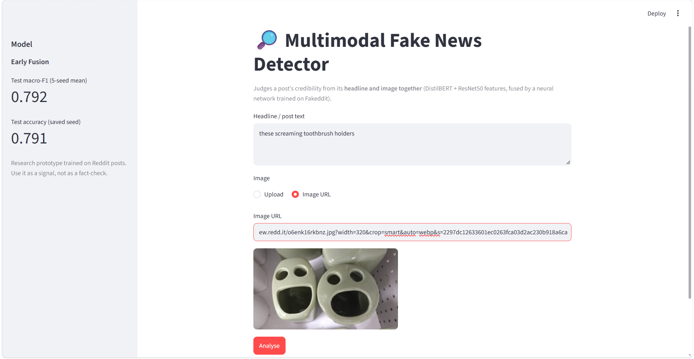
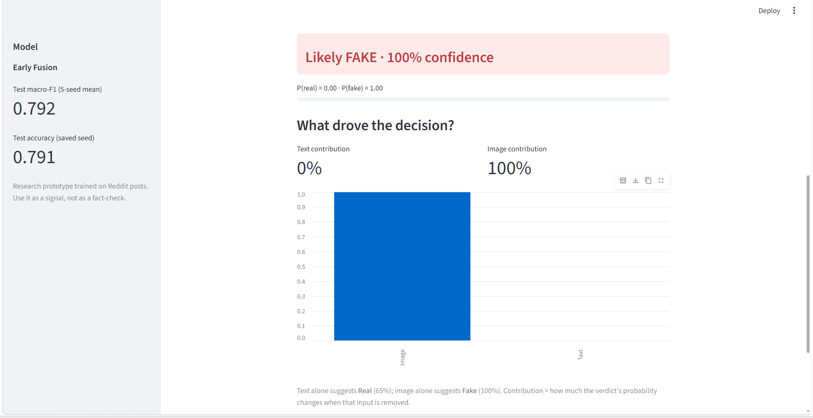
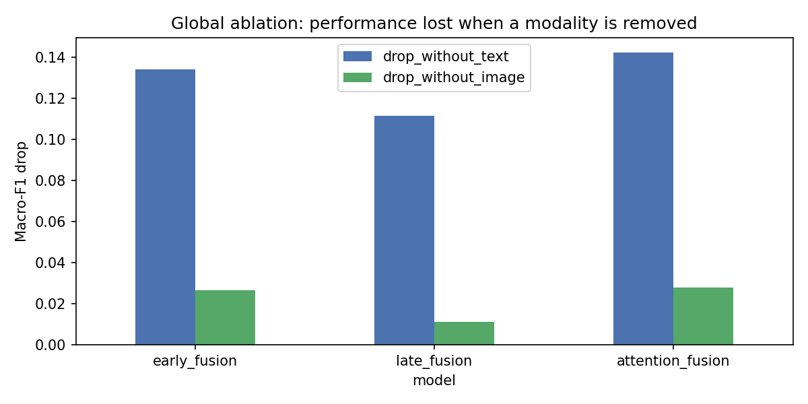
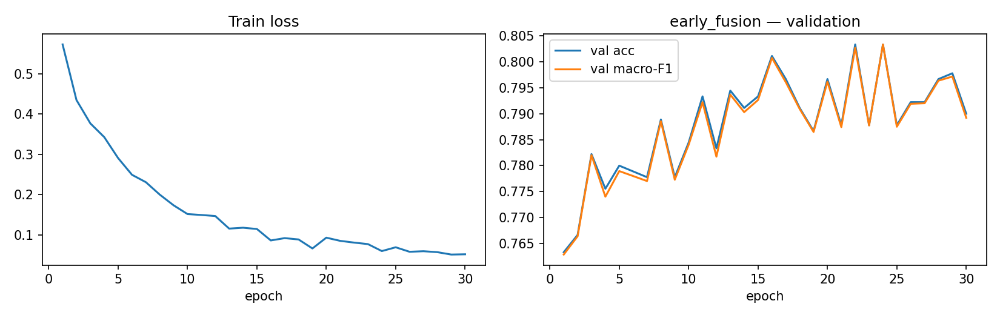

# Multimodal Fake News Detection using Text–Image Fusion

Detects fake Reddit posts (Fakeddit, 2-way labels: 0 = fake, 1 = real) by combining what the **headline says** (DistilBERT, 768-d) with what the **image shows** (ResNet50, 2048-d). Features are frozen; small neural networks are trained on top and compared with classical TF-IDF baselines.

## Files

| File / folder | What it is |
|---|---|
| `Multimodal_Fake_News_Detection.ipynb` | Full Kaggle notebook: data → balanced subset → features → 5 models × 5 seeds → results → ablation → save |
| `fakenews_core.py` | Shared feature extractors, models and explanation code |
| `app.py` | Streamlit web app |
| `models/` | Trained best model (`best_model.pt`), `config.json`, `feature_stats.npz` |
| `outputs/` | Result tables, plots and per-post explanations produced by the notebook |
| `data/` | The 6,000-post train/val and 1,500-post test subsets (ids, titles, image URLs, labels) |
| `screenshots/` | App screenshots |
| `requirements.txt` | Dependencies for running the app locally |

## Dataset and subset

- Dataset: Fakeddit (Nakamura et al., LREC 2020), 2-way labels.
- Subset: 6,000 training posts (split 85/15 into 5,100 train / 900 validation) and 1,500 held-out test posts, balanced by label.
- Image hosts are matched across classes (`preview.redd.it` and `external-preview.redd.it` only, equal numbers per class), so a model cannot use the image host as a shortcut for the label.
- Headlines are truncated to 64 tokens; images are resized to 224×224. Split seed is fixed (42); only model seeds vary.

## How to run

### Train and evaluate (Kaggle)
1. Download `multimodal_train.tsv` and `multimodal_test_public.tsv` from the [Fakeddit repository](https://github.com/entitize/Fakeddit) (`multimodal_only_samples` folder) and upload them as a Kaggle dataset.
2. Import the notebook, attach the dataset, set **Accelerator = GPU** and **Internet = On**.
3. Set the dataset paths in the setup cell, then run the cells in order (image download and feature extraction take several minutes).

### Run the app locally
```bash
pip install -r requirements.txt
streamlit run app.py
```
`app.py`, `fakenews_core.py` and the `models/` folder must be in the same directory. The first launch downloads the DistilBERT and ResNet50 weights, so internet is needed.

## App





The app takes a headline and an image (upload or URL) and shows the verdict, its confidence, and how much the text and the image each drove the decision.

## Results

Fixed test split of 1,500 posts. Frozen-feature models: mean ± std over 5 seeds. TF-IDF baselines: single run (text only).

| Model | Accuracy | Macro-F1 |
|---|---|---|
| TF-IDF + LogReg | 0.7273 | 0.7271 |
| TF-IDF + RandomForest | 0.7087 | 0.7086 |
| TF-IDF + DecisionTree | 0.6800 | 0.6797 |
| TF-IDF + GradBoost | 0.6800 | 0.6789 |
| Image only | 0.6776 ± 0.0074 | 0.6758 ± 0.0067 |
| Text only | 0.7732 ± 0.0038 | 0.7731 ± 0.0037 |
| Late fusion | 0.7808 ± 0.0093 | 0.7805 ± 0.0093 |
| Attention fusion | 0.7860 ± 0.0008 | 0.7859 ± 0.0008 |
| **Early fusion (best by validation F1)** | **0.7924 ± 0.0030** | **0.7922 ± 0.0029** |

### Findings
- Early fusion is the best model (macro-F1 0.792), about 1.9 points above text-only (0.773) and about 6.5 points above the best TF-IDF baseline (0.727).
- The fusion gain over text-only is consistent across seeds (early fusion is better on 5/5 seeds) but small. A McNemar test on seed 0 gives p = 0.086 for early fusion, 0.211 for attention fusion and 0.947 for late fusion, so none reaches significance at 0.05 on this 1,500-post test set.
- Text drives most decisions: removing it costs 0.11–0.14 macro-F1, versus 0.01–0.03 for removing the image.

### Global ablation (mean macro-F1 over 5 seeds)

| Model | Full | Text removed | Image removed | Drop without text | Drop without image |
|---|---|---|---|---|---|
| Early fusion | 0.7922 | 0.6583 | 0.7657 | 0.1339 | 0.0265 |
| Late fusion | 0.7805 | 0.6691 | 0.7694 | 0.1114 | 0.0111 |
| Attention fusion | 0.7859 | 0.6436 | 0.7580 | 0.1422 | 0.0279 |





## Limitations
- Features are frozen; fine-tuning DistilBERT and ResNet50 end to end (or using CLIP) would likely score higher but needs more GPU time.
- The training set is a 6,000-post subset of a much larger dataset, and the test set is a single fixed split of 1,500 posts, so differences of 1–2 points between fusion models are within sampling noise.
- Fakeddit labels come from subreddit membership (distant supervision), so some labels are noisy. Image-only accuracy is above chance, but the images may be predicting subreddit style rather than falsehood.
- Dead image links make the subset slightly biased toward posts whose images still load.
- Validation macro-F1 fluctuates by about ±0.01 between epochs (900 validation posts), so checkpoint selection is noisy.
- The ablation shows which modality mattered, not which words or image regions.
- Research prototype trained on Reddit posts: use it as a signal, not as a fact-check.